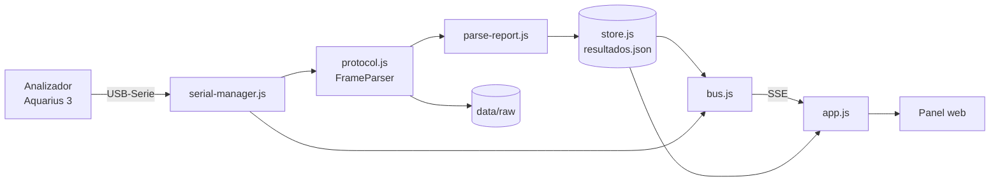

# Hematología · Servidor de resultados

[](https://nodejs.org/)
[](https://nodejs.org/api/esm.html)
[](https://serialport.io/)
[](#requisitos)

Servidor local que escucha un analizador hematológico **Diatron Aquarius 3** por
**USB-Serie**, decodifica su protocolo propietario y publica los resultados en un
**panel web en vivo** con parámetros, alertas e histogramas.

```
┌──────────────────┐   USB-Serie    ┌──────────────┐   HTTP/SSE   ┌──────────────┐
│ Diatron Aquarius │  115200 8N1    │   Node.js    │  127.0.0.1   │  Panel web   │
│        3         │ ─────────────► │  (servidor)  │ ───────────► │  (navegador) │
└──────────────────┘      COM3      └──────────────┘              └──────────────┘
```

---

## Tabla de contenidos

- [Características](#características)
- [Requisitos](#requisitos)
- [Inicio rápido](#inicio-rápido)
- [Configuración](#configuración)
- [Panel web](#panel-web)
- [API local](#api-local)
- [Protocolo Diatron](#protocolo-diatron)
- [Arquitectura](#arquitectura)
- [Datos y persistencia](#datos-y-persistencia)
- [Pruebas](#pruebas)
- [Scripts de Windows](#scripts-de-windows)
- [Seguridad y privacidad](#seguridad-y-privacidad)
- [Solución de problemas](#solución-de-problemas)
- [Documentación adicional](#documentación-adicional)

---

## Características

- **Escucha permanente** del puerto serie con **reconexión automática** cada 3 s
  (puerto ocupado, cable desconectado o equipo apagado).
- **Protocolo Diatron** decodificado con parser incremental y **validación de checksum**.
- **Panel web en tiempo real** mediante *Server-Sent Events* (SSE).
- **22 parámetros hematológicos** con flags `H`/`L`, rangos de referencia y alertas.
- **Histogramas** WBC, RBC y PLT dibujados en `<canvas>`.
- **Búsqueda** por paciente, muestra o ID y **exportación JSON**.
- **Configuración en caliente** del puerto serie desde el panel, sin reiniciar.
- **Persistencia** en JSON y **auditoría** de tramas crudas (`.bin` / `.hex`).
- **Arquitectura modular** con ES Modules, sin framework y con una sola dependencia.

## Requisitos

| Componente | Versión / nota |
|---|---|
| Node.js | **≥ 18.17** (probado con v24) |
| npm | Incluido con Node.js |
| Sistema | Windows (scripts `.bat` / PowerShell incluidos) |
| Puerto serie | Driver USB-Serie del analizador instalado |
| Hardware | Diatron Aquarius 3 · **115200 8N1** · `COM3` por defecto |

## Inicio rápido

```powershell
git clone https://github.com/ceslep/hematprg-servidor.git
cd hematprg-servidor
npm install
npm start
```

Abrir el panel en **http://127.0.0.1:3000**.

En Windows también se puede iniciar con doble clic en **`Iniciar servidor.bat`**
y detener con **`Detener servidor.bat`**.

> El puerto `COM3` debe estar libre. Si no está disponible, el servidor reintenta
> automáticamente y permite cambiarlo desde **⚙ Configuración**.

## Configuración

La configuración se resuelve en este orden de prioridad:

1. `data/config.json` (guardado desde el panel).
2. Variables de entorno.
3. Valores por defecto.

| Variable | Por defecto | Descripción |
|---|---|---|
| `SERIAL_PORT` | `COM3` | Puerto serie del analizador |
| `BAUD` | `115200` | Velocidad en baudios |
| `SERIAL_ACK` | `0` | `1` = responder `ACK` al recibir `ENQ` |
| `RECONNECT_MS` | `3000` | Espera entre reintentos del puerto |
| `HOST` | `127.0.0.1` | Interfaz de escucha HTTP |
| `PORT` | `3000` | Puerto HTTP del panel |

Ejemplo:

```powershell
$env:PORT='3001'; $env:SERIAL_PORT='COM4'; npm start
```

Los cambios de **host/puerto HTTP** requieren reiniciar el proceso; los del
**puerto serie** se aplican en caliente y persisten en `data/config.json`.

## Panel web

| Zona | Contenido |
|---|---|
| Cabecera | Estado del puerto, equipo detectado, total de resultados y configuración |
| Columna izquierda | Resultados con alertas y búsqueda |
| Columna derecha | Datos del paciente, parámetros, histogramas e informe original |

Acciones disponibles: buscar, abrir detalle, descargar JSON, imprimir y eliminar
resultados. El botón **⚙ Configuración** permite elegir entre los puertos detectados
o escribir uno manualmente, ajustar baudios, bits, paridad, parada y reintentos.

## API local

| Método | Ruta | Descripción |
|---|---|---|
| `GET` | `/api/estado` | Estado del servidor, puerto serie y configuración |
| `GET` | `/api/equipo` | Identificación del analizador |
| `GET` | `/api/config` | Configuración actual, valores por defecto y puertos |
| `POST` | `/api/config` | Valida, guarda y aplica configuración |
| `GET` | `/api/puertos` | Puertos serie detectados en el sistema |
| `GET` | `/api/resultados` | Lista de resultados (`?q=` para buscar) |
| `GET` | `/api/resultados/:id` | Detalle completo de un resultado |
| `DELETE` | `/api/resultados/:id` | Elimina un resultado |
| `GET` | `/api/export.json` | Exporta equipo y resultados |
| `GET` | `/api/eventos` | Stream SSE: `estado`, `equipo`, `resultado` |
| `POST` | `/api/dev/replay` | Solo pruebas: inyecta una trama `{"hex":"01 49 …"}` |

Ejemplo de actualización de configuración:

```powershell
Invoke-RestMethod -Uri http://127.0.0.1:3000/api/config -Method Post `
  -ContentType 'application/json' `
  -Body '{"serialPath":"COM3","baudRate":115200,"dataBits":8,"parity":"none","stopBits":1}'
```

## Protocolo Diatron

Trama observada en el Aquarius 3:

```
SOH │ prefijo (2 ASCII) │ STX │ texto │ ETX │ checksum (2 hex) │ EOT
0x01│  secuencia + tipo │0x02 │ ...   │0x03 │      "A7"        │0x04
```

- **Prefijo:** primer byte = secuencia; segundo = tipo (`I` identificación, `N` informe).
- **Checksum:** suma de los bytes desde el prefijo (incluido) hasta `ETX` (incluido), `& 0xFF`.
- Las tramas con checksum inválido se registran y se descartan.
- Cada trama válida se archiva en `data/raw/<timestamp>_<TIPO>.{bin,hex}`.

El parser es incremental: tolera fragmentación del stream, bytes de ruido y
paquetes concatenados.

## Arquitectura



| Módulo | Responsabilidad |
|---|---|
| `server.js` | Punto de entrada: cablea dependencias y arranca HTTP/serie |
| `src/config.js` | Configuración, validación, persistencia y puertos |
| `src/protocol.js` | Constantes y `FrameParser` incremental |
| `src/parse-report.js` | Informe de texto → objeto estructurado |
| `src/serial-manager.js` | Apertura, reconexión, decodificación y archivado |
| `src/store.js` | Almacén JSON de resultados |
| `src/status.js` | Estado en memoria |
| `src/bus.js` | Bus de eventos (`EventEmitter`) |
| `src/app.js` | HTTP, API REST, SSE y archivos estáticos |
| `src/logger.js` | Log con rotación |
| `src/util.js` | Utilidades (`stamp`, `hex`) |
| `public/` | Panel web (HTML/CSS/JS con módulos ES) |

## Datos y persistencia

```
data/
├─ config.json      # configuración persistente
├─ resultados.json  # almacén de resultados + equipo
├─ servidor.log     # log con rotación (2 MB)
├─ servidor.pid     # PID del proceso en ejecución
└─ raw/             # tramas crudas .bin y .hex
```

> `data/` está excluido de Git: contiene **datos clínicos de pacientes**.
> Nunca lo subas a un repositorio ni lo compartas sin anonimizar.

Si se pierde `resultados.json`, se puede reconstruir desde las tramas crudas:

```powershell
npm run recuperar
```

## Pruebas

La prueba end-to-end inyecta una trama, comprueba la recepción por SSE, verifica el
parser y el almacenamiento, y borra únicamente los datos que ella misma creó.

```powershell
# Con el servidor en ejecución en otra terminal:
npm test
```

## Scripts de Windows

| Archivo | Función |
|---|---|
| `Iniciar servidor.bat` | Arranca el servidor y abre el panel |
| `Detener servidor.bat` | Detiene el proceso en ejecución |
| `start.ps1` | Arranque con reinicio automático si el proceso cae |
| `Instalar autoinicio.ps1` | Crea un acceso directo en el inicio de Windows |

## Seguridad y privacidad

- El panel escucha **solo en `127.0.0.1`** por defecto: no es accesible desde la red.
- No hay autenticación. **No expongas el servidor a Internet** ni a la red local sin
  añadir HTTPS y control de acceso.
- Los datos de pacientes permanecen en el equipo local, en `data/`.
- El endpoint `/api/dev/replay` está pensado para pruebas locales.
- Este software **no es un dispositivo médico certificado**: es una herramienta de
  visualización. No debe usarse como única base para decisiones clínicas.

## Solución de problemas

| Síntoma | Causa probable | Solución |
|---|---|---|
| `EADDRINUSE` | Puerto HTTP ocupado | `$env:PORT='3001'; npm start` |
| No abre `COM3` | Puerto ocupado o cable desconectado | Cerrar otros programas, revisar cable |
| No llegan resultados | Baudios/paridad incorrectos | Ajustar en **⚙ Configuración** |
| Checksum inválido | Ruido o configuración serie errónea | Revisar baudios y cableado |
| El panel no carga | Servidor detenido | Ejecutar `npm start` |

## Documentación adicional

Guía detallada en español (instalación, autoinicio, recuperación y operación):
**[README_SERVIDOR.md](README_SERVIDOR.md)**

---

Hecho para el laboratorio de hematología · Diatron Aquarius 3.
